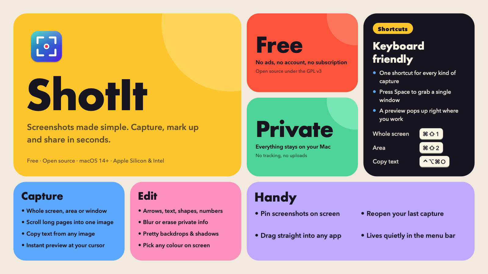
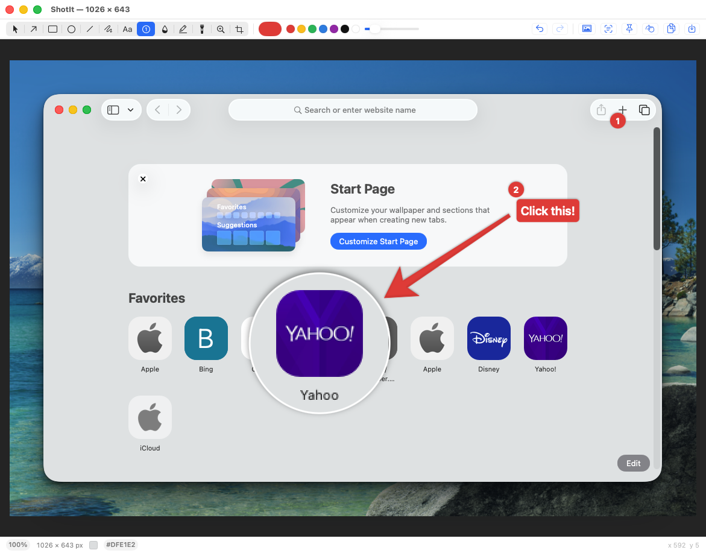
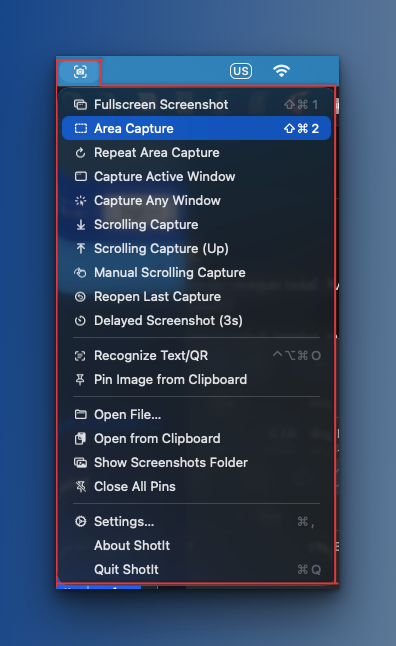

<h1 align="center">ShotIt</h1>

<p align="center">
  
</p>

<p align="center">
  <b>Screenshots made simple.</b> Grab your screen, mark it up and share it in seconds.<br>
  A free, private app for your Mac's menu bar.
</p>

<p align="center">
  <a href="../../releases/latest"></a>
  
  
  
</p>

## Screenshots

<p align="center">
  
  &nbsp;&nbsp;
  
</p>
<p align="center"><sub>Mark up with arrows, numbers, text and a magnifier (left). Every capture is one click or one shortcut away in the menu bar (right).</sub></p>

## Why you'll like it

- **Grab anything.** The whole screen, an area, or a single window with its native rounded corners. While selecting an area, press **Space** to switch to picking a window, just like the built-in macOS screenshot.
- **Long pages in one image.** Scrolling capture scrolls for you (or follows you) and stitches the result into one tall picture.
- **Mark up fast.** Arrows, boxes, text, numbered steps, highlighter, spotlight and magnifier.
- **Hide private info.** Blur, pixelate or erase a whole area, or only the text in it. Erase repaints cleanly and keeps the background's gradient and grain.
- **Make it look good.** Put a screenshot on your wallpaper, a gradient or an image, with a soft shadow that follows the window's real corners.
- **Copy text from any image.** Recognize text and QR codes in any region and copy the result.
- **Keep it handy.** Pin a screenshot on top of everything, drag a preview straight into another app, or reopen your last capture.
- **Free and private.** No account, no ads, no tracking. Everything stays on your Mac.

Default shortcuts: **⌘⇧1** whole screen, **⌘⇧2** area, **⌃⌥⌘O** copy text from the screen. Everything else can be
set in **Settings › Shortcuts**. Settings warns you when a shortcut clashes with macOS or another app, and can swap the built-in ⌘⇧3 / ⌘⇧4 screenshot shortcuts for ShotIt's with one click.

## Install

1. Download the latest `ShotIt-<version>.dmg` from the [Releases](../../releases) page, open it and drag **ShotIt** into **Applications**.
2. ShotIt is not notarized by Apple, so macOS blocks the first launch. Click **Done**, open
   **System Settings › Privacy & Security**, scroll to the message about ShotIt and click **Open Anyway**.
   (Terminal alternative: `xattr -dr com.apple.quarantine /Applications/ShotIt.app`.)
3. Allow **Screen & System Audio Recording** when asked, then relaunch ShotIt. Auto-scrolling capture also needs **Accessibility**.

Or build it yourself, below.

## Features

| Feature | Details |
|---|---|
| Fullscreen capture | Display under the pointer |
| Area capture | Frozen-screen overlay, crosshair guides, live pixel size, Shift = square, Enter = whole screen |
| Repeat area capture | Re-grab the same area again with one shortcut |
| Active window / any window | Click a highlighted window or drag an area; native rounded corners; optional shadow. During area capture, press Space to switch to picking a window. ShotIt's own Settings/editor windows can be captured too |
| Delayed screenshot (3 s) | Gives you time to open a menu or hover state first |
| Recognize Text / QR | Vision OCR + barcode; copies to clipboard |
| Thumbnail preview | Copy · Save · Edit · Pin · OCR, auto-hide, drag out to other apps |
| Editor tools | Erase repaints only objects/text and keeps the background's gradient and grain. Arrow A · Rectangle R · Oval O · Line L · Freehand D · Text T · Counter C · Blur/Pixelate/Erase B (each also available as Blur Text / Erase Text, which only touch detected text) · Highlighter H · Spotlight S · Magnifier M · Crop X · Select V |
| Editor extras | Undo/redo, move/resize handles, Shift constraints, arrow-key nudge, zoom (pinch, ⌘= ⌘- ⌘0 ⌘1), colour under cursor in 6 formats (I copies), `[` `]` size |
| Pin to screen | Always-on-top; scroll = resize, ⌥-scroll = opacity, double-click/Esc closes |
| Open file / clipboard image | Also via Finder "Open With" |
| Settings | After-capture actions, save folder & format, Retina downscale, Esc behaviour, launch at login, hotkey recorder with per-shortcut clear/reset, conflict warnings, one-click replacement of the built-in macOS screenshot shortcuts |
| URL scheme | `shotit://grab/area?then=copy,pin` (see Settings › Advanced) |
| Scrolling capture | Auto-scroll (needs Accessibility), Up, and Manual modes; sticky headers/footers handled; stitched into one tall image |
| Backdrop (K) | Wallpaper (your current desktop picture, automatic — the default), Auto (colours from the screenshot), gradient, solid or image; padding, layered shadow with a Depth control that follows the window's native rounded corners, aspect ratio, grain. Applied on copy/save/pin/drag; remembered between sessions |

## For developers

### Build from source

Requires macOS 14+, Xcode and [xcodegen](https://github.com/yonaskolb/XcodeGen) (`brew install xcodegen`).

```sh
tools/make-signing-cert.sh   # once: creates a local self-signed "ShotIt Local" signing certificate
tools/install.sh             # builds Release, signs, installs to /Applications/ShotIt.app and launches it
```

macOS ties Screen Recording and Accessibility grants to the app's code signature. An ad-hoc signature changes on every
build, so the permission would be asked again after each rebuild. Signing with the local certificate keeps the
requirement stable (`com.shotit.app` + that certificate), so you grant each permission once. The certificate lives only
in your login keychain and is tied to no Apple account. During setup macOS may ask you to trust it, and the first
install may ask for keychain access to the key: choose **Always Allow**, or run `tools/make-signing-cert.sh --allow-codesign`.
Set `SIGN_IDENTITY="<name>"` to use a different certificate. A build signed this way runs on your Mac only; it is not
a distributable binary (that needs a Developer ID certificate and notarization).

### Distributing a DMG

```sh
tools/make-dmg.sh           # → dist/ShotIt-<version>.dmg (universal: Apple Silicon + Intel)
tools/make-dmg.sh --adhoc   # ad-hoc signature instead of the "ShotIt Local" certificate
```

The DMG is **not notarized**, so Gatekeeper blocks the first launch on other Macs. On macOS 15 and later users must
open **System Settings › Privacy & Security** and click **Open Anyway** (right-click › Open no longer works there);
the DMG includes a "First launch" note with the steps, or run `xattr -dr com.apple.quarantine /Applications/ShotIt.app`.
Sign every release with the same certificate: macOS keeps Screen Recording / Accessibility grants across updates only
when the signing requirement stays the same, so an ad-hoc build asks again after each update. Back up the
"ShotIt Local" certificate from your keychain; if you lose it, users re-grant once. Skipping the prompt entirely needs a
paid Apple Developer ID certificate and notarization (`SIGN_IDENTITY="Developer ID Application: …"`).

Manual build and tests:

```sh
xcodegen generate                       # project.yml → ShotIt.xcodeproj
xcodebuild -project ShotIt.xcodeproj -scheme ShotIt -configuration Release \
  -derivedDataPath build/DerivedData build
xcodebuild -project ShotIt.xcodeproj -scheme ShotIt -derivedDataPath build/DerivedData test
```

On first capture macOS asks for **Screen & System Audio Recording** permission; grant it and relaunch.
Auto-scrolling capture additionally needs **Accessibility**.

### Layout

```
Sources/ShotIt/
  App/       AppDelegate (+ URL scheme), StatusMenu, CaptureCoordinator, HotKeys (Carbon), Settings
  Capture/   ScreenCapturer (ScreenCaptureKit), RegionSelector (area/window overlay)
  Core/      Exporter (clipboard/files), TextRecognizer (Vision), Toast, shared controls
  Editor/    EditorWindowController, CanvasView, EditorDocument (undo, crop), Annotation + renderer
  Preview/   PreviewPanel (floating thumbnail)
  Pin/       PinWindowController
  Prefs/     SwiftUI settings window + shortcut recorder
Tests/ShotItTests/  rendering, crop/undo, hit-testing, colour formats, offscreen editor snapshot
```

## About

ShotIt is inspired by [Shottr](https://shottr.cc). It is an independent project and is not affiliated with or endorsed by Shottr.

ShotIt is free software, licensed under the [GNU GPL v3](LICENSE).
